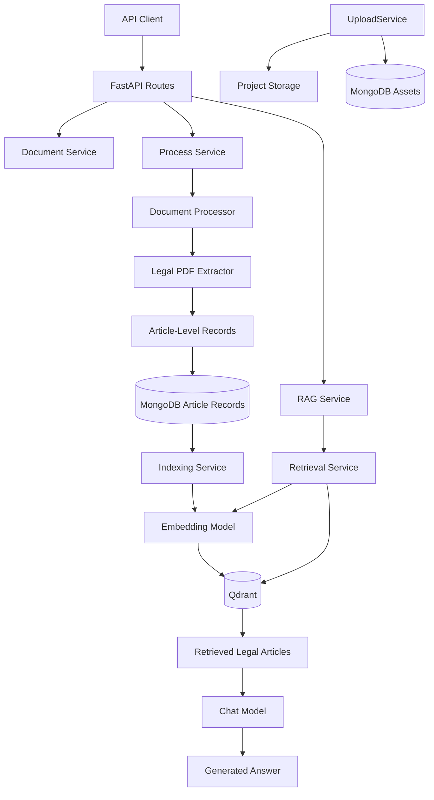

# QanunMasr RAG

A domain-specific Retrieval-Augmented Generation (RAG) backend for the Egyptian Civil Code, built with FastAPI, MongoDB, Qdrant, and configurable LLM and embedding providers.

The system processes a bilingual Arabic-English Egyptian Civil Code PDF, extracts individual legal articles, stores article text and metadata, indexes the content, and retrieves relevant legal provisions to support source-grounded answers.

The backend follows a modular service-based architecture. Document handling, legal processing, vector indexing, retrieval, and answer generation have separate responsibilities.

---

## Key Features

- **Legal PDF extraction:** Extracts numbered articles from the Egyptian Civil Code.
- **Bilingual corpus:** Stores Arabic and English legal text separately.
- **Article-level processing:** Uses individual articles as the primary legal record and retrieval unit.
- **Legal metadata:** Preserves article number, book, chapter, section, topic, repeal status, source page, and citation.
- **PDF layout processing:** Uses PyMuPDF to extract table content and positioned text.
- **Document handling:** Keeps document upload and file storage separate from legal processing.
- **MongoDB persistence:** Stores projects, uploaded assets, article records, and metadata.
- **Vector indexing:** Generates embeddings and stores vectors in Qdrant.
- **Semantic retrieval:** Finds relevant article records for user questions.
- **Pluggable model providers:** Supports Ollama for local inference and OpenRouter as an alternative provider.
- **Source-aware answers:** Preserves legal citations and source-page information for source verification.
- **Centralized logging:** Records application, processing, and indexing events.
- **API documentation:** Provides request and response schemas through FastAPI Swagger UI.

---

## Architecture

The application uses a service-based architecture. FastAPI routes expose the API, while services coordinate document handling, legal PDF processing, indexing, retrieval, and answer generation.

### High-Level Architecture



### Service Responsibilities

**Upload Service**

Handles the document upload and storage flow. Uploaded files are validated, saved through the storage component, and associated with the relevant project and asset records.

**Process Service**

Coordinates document processing. It uses the document processor and legal extraction logic to transform the source PDF into article-level records, then maps the extracted records to the application's storage schema.

**Document Processor**

Handles PDF content extraction and normalization. The legal extractor identifies article boundaries, legal hierarchy, Arabic and English text, repeal status, and source metadata.

**Indexing Service**

Loads stored article records, prepares searchable text, generates embeddings, and indexes the records in Qdrant.

**Retrieval Service**

Embeds a user question and searches Qdrant for relevant article records. Retrieved context retains the article information needed for source identification.

**RAG Service**

Coordinates retrieval and answer generation through the configured chat model.

---

## Main Flows

### 1. Document Flow

```text
API Request
    ↓
Document Service
    ↓
File Validation
    ↓
Project Storage
    ↓
MongoDB Asset Metadata
```

The document-handling flow remains distinct from legal text extraction. This separation makes it possible to reuse document storage when uploading a newer version of a legal PDF or another supported document.

### 2. Legal Processing Flow

```text
API Request
    ↓
Process Service
    ↓
Document Processor
    ↓
Legal PDF Extractor
    ↓
Article-Level Records
    ↓
MongoDB
```

The processor extracts the legal articles and their metadata. The processing service maps those records to the application's data schema and stores them for indexing.

### 3. Indexing Flow

```text
Stored Article Records
    ↓
Indexing Service
    ↓
Prepare Searchable Text
    ↓
Embedding Model
    ↓
Qdrant Vector Index
```

Article identity and legal metadata are preserved during indexing so retrieved records can be associated with their original provisions.

### 4. RAG Query Flow

```text
User Question
    ↓
RAG Service
    ↓
Retrieval Service
    ↓
Query Embedding
    ↓
Qdrant Search
    ↓
Relevant Legal Articles
    ↓
Chat Model
    ↓
Generated Answer
```

The retrieved article records provide the context used to generate an answer. Extraction quality and the relevance of the retrieved context affect the reliability of the final response.

---

## Dataset & Legal Corpus

### Dataset Overview

The current corpus is derived from a 170-page bilingual Egyptian Civil Code PDF. The source contains English text on the left and Arabic text on the right.

The extraction pipeline produces 1,149 numbered article records covering Articles 1 through 1149.

| Property | Description |
|---|---|
| Source | Egyptian Civil Code PDF |
| Source length | 170 pages |
| Languages | Arabic and English |
| Primary record unit | One legal article |
| Article-number coverage | Articles 1–1149 |
| Hierarchy | Book, chapter, section, and topic |
| Repeal information | `is_repealed` |
| Source tracking | `source_page` and `citation` |

### Extraction and Processing

The processor uses PyMuPDF to extract table content and positioned text from the PDF. Article-number recognition, English headings, bold formatting, and page layout are used to infer the legal hierarchy and associate the extracted text with the corresponding article.

The extraction pipeline also performs selected English line-break and spacing corrections. Arabic extraction still has known reading-order and formatting limitations.

Extracted records undergo structural validation to identify missing or inconsistent records. Structural validation does not guarantee perfect text extraction, so records that are important for legal use must still be verified against the source.

### Article Data Structure

Hierarchy titles are stored in English only. Arabic and English provision text are stored separately in `text_ar` and `text_en`.

Example extracted article:

```json
{
  "article_number": 977,
  "book": "BOOK III The Principal Real Rights",
  "chapter": "Chapter I The Right of Ownership",
  "section": "Section II Acquisition of Ownership",
  "topic": "The Acquisition of Movables by Prescription",
  "text_en": "...",
  "text_ar": "...",
  "is_repealed": false,
  "source_page": 141,
  "citation": "Egyptian Civil Code, Article 977"
}
```

The stored `DataChunk` also includes application and retrieval fields.

| Field | Purpose |
|---|---|
| `chunk_text` | Combined searchable text with article identity and available content |
| `chunk_metadata` | Additional metadata used by processing and retrieval |
| `chunk_order` | Record sequence within the project's chunk records |
| `chunk_project_id` | Associated project identifier |
| `chunk_asset_id` | Associated uploaded asset identifier |
| `article_number` | Legal article number |
| `book` | English book title |
| `chapter` | English chapter title |
| `section` | English section title |
| `topic` | English topic or heading |
| `text_ar` | Extracted Arabic provision |
| `text_en` | Extracted English provision |
| `is_repealed` | Whether the article is flagged as repealed |
| `source_page` | Page number in the source PDF |
| `citation` | Human-readable article citation |

### Repealed Provisions

The current extraction configuration flags these article ranges as repealed:

- Articles 54–80.
- Articles 389–417.

The records retain their repeal status through the `is_repealed` field. Downstream components must not present a flagged provision as currently applicable law without checking its legal status against an authoritative source.

### Current Limitations

- **Arabic extraction:** Some records contain reading-order, spacing, glyph, punctuation, or paragraph-numbering issues. Current normalization is partial.
- **English normalization:** Line-break and spacing corrections are heuristic and may not cover every edge case.
- **Heading classification:** Book, chapter, section, and topic detection partly depends on PDF formatting, so some headings may need manual review.
- **Source omission:** Article 1022 has no Arabic body text in the supplied PDF. The extractor does not fabricate missing Arabic text.
- **Extraction quality:** Continuous article numbering does not guarantee that all article text and headings have been extracted correctly.
- **Legal verification:** Repeal flags and extracted provisions should be verified against authoritative legal sources before being used for legal decisions.

### Planned Improvements

1. Improve Arabic text extraction using layout-aware processing and OCR where appropriate.
2. Compare representative extracted articles against the original PDF.
3. Refine heading classification and article-boundary detection.
4. Expand validation for text completeness, malformed numbering, and extraction anomalies.
5. Track extraction issues and review updated versions of the source PDF consistently.

---

## Tech Stack

| Category | Technologies |
|---|---|
| Language | Python 3.11+ |
| API | FastAPI, Uvicorn |
| Configuration | Pydantic, Pydantic Settings |
| PDF processing | PyMuPDF |
| Chat model providers | Ollama, OpenRouter |
| Embeddings | Configurable embedding provider |
| Document database | MongoDB |
| Vector database | Qdrant |
| Dependency management | uv |
| Code quality | Ruff, pre-commit |
| Development environment | WSL2 |

---

## Project Structure

The following tree highlights the main modules involved in the current legal document pipeline. Infrastructure and supporting modules are abbreviated for readability.

```text
qanun-masr-rag/
├── src/
│   ├── core/
│   │   ├── dependencies.py
│   │   └── exceptions.py
│   ├── models/
│   │   ├── asset_model.py
│   │   ├── chunk_model.py
│   │   ├── project_model.py
│   │   ├── db_schemes/
│   │   │   └── ...
│   │   └── enums/
│   │       └── ...
│   ├── routes/
│   │   ├── data.py
│   │   ├── rag.py
│   │   └── schemes/
│   │       └── ...
│   ├── services/
│   │   ├── processing/
│   │   │   ├── document_processor.py
│   │   │   ├── processing_service.py
│   │   │   └── egyptian_law/
│   │   │       └── extractor.py
│   │   ├── storage/
│   │   │   ├── project_storage.py
│   │   │   └── upload_service.py
│   │   ├── rag/
│   │   │   ├── indexing_service.py
│   │   │   ├── retrieval_service.py
│   │   │   └── rag_service.py
│   │   ├── llm/
│   │   │   └── ...
│   │   ├── prompts/
│   │   │   └── rag/
│   │   │       ├── arabic.py
│   │   │       └── english.py
│   │   └── vectordb/
│   │       ├── providers/
│   │       │   └── qdrant.py
│   │       └── ...
│   ├── utils/
│   │   ├── logger.py
│   │   └── metrics.py
│   └── main.py
├── tests/
│   └── ...
├── evals/
│   └── ...
├── pyproject.toml
├── uv.lock
└── README.md
```

### Key Module Responsibilities

- **`routes/`:** Exposes the API endpoints and connects incoming requests to the appropriate service.
- **Document Service:** Handles the document upload and storage workflow.
- **`processing/processing_service.py`:** Coordinates extraction and storage of legal article records.
- **`processing/document_processor.py`:** Handles PDF content extraction and processing.
- **`processing/egyptian_law/extractor.py`:** Provides the legal PDF extraction logic.
- **`storage/project_storage.py`:** Manages the project's uploaded file storage.
- **`storage/upload_service.py`:** Implements file validation and upload handling.
- **`rag/indexing_service.py`:** Generates embeddings for stored article records and indexes them in Qdrant.
- **`rag/retrieval_service.py`:** Retrieves relevant records for a query.
- **`rag/rag_service.py`:** Coordinates retrieval and answer generation.
- **`models/`:** Defines database models and the stored article schema.
- **`utils/`:** Contains shared utilities, logging, and metrics.

The exact filenames in the checked-out repository take precedence over this overview if modules are subsequently reorganized.

---

## Docker Setup

For Docker Compose commands, the isolated Ragas evaluation container, and optional DVC setup with MinIO, see the [Docker README](docker/README.md).

---

## Prerequisites

- Python 3.11 or newer.
- `uv` for Python dependency management.
- MongoDB.
- Qdrant.
- Ollama when using local inference.
- An OpenRouter API key when using OpenRouter models.

Make sure the required databases and model providers are reachable from the URLs configured in the application.

For Ollama, verify the installed models using:

```bash
ollama list
```

---

## Installation & Setup

### 1. Enter the Project Directory

```bash
cd ~/projects/OrangeHub/qanun-masr-rag
```

### 2. Install Dependencies

```bash
uv sync
```

### 3. Configure Environment Variables

Create or update the `.env` file in the project root with the settings required by the application's Pydantic configuration.

Do not commit API keys, passwords, or other secrets to Git.

### 4. Start Infrastructure

Start MongoDB and Qdrant, and ensure the configured chat and embedding providers are available.

Verify that Ollama is reachable when using local models:

```bash
ollama list
```

### 5. Run the API

From the project root:

```bash
PYTHONPATH=src uv run uvicorn main:app --host 0.0.0.0 --port 8001
```

Local API address:

```text
http://localhost:8001
```

Swagger UI:

```text
http://localhost:8001/docs
```

Use Swagger UI to inspect the request and response schemas exposed by the running application.

---

## Environment Variables

The following table summarizes the main configuration settings. The actual required fields and defaults are defined in the application's settings classes.

| Variable | Purpose |
|---|---|
| `APP_NAME` | Application name |
| `APP_VERSION` | Application version |
| `LOG_LEVEL` | Application logging level |
| `FILE_ALLOWED_TYPES` | Allowed uploaded file MIME types |
| `FILE_MAX_SIZE` | Maximum permitted upload size |
| `FILE_DEFAULT_CHUNK_SIZE` | File-processing read size |
| `MONGODB_URL` | MongoDB connection URL |
| `MONGODB_DATABASE` | MongoDB database name |
| `OLLAMA_BASE_URL` | Ollama server URL |
| `OPENROUTER_API_KEY` | API key when using OpenRouter |
| `CHAT_MODELS` | Chat model and provider configuration |
| `CHAT_PRIMARY_MODEL` | Primary chat model selection |
| `CHAT_FALLBACK_MODEL` | Fallback chat model selection |
| `CHAT_FALLBACK_COOLDOWN_SECONDS` | Fallback strategy cooldown |
| `EMBEDDING_MODELS` | Embedding model and provider configuration |
| `EMBEDDING_MODEL` | Selected embedding model |
| `QDRANT_URL` | Qdrant server URL |
| `QDRANT_API_KEY` | Qdrant API key, if required |
| `QDRANT_COLLECTION_NAME` | Target vector collection |
| `QDRANT_VECTOR_SIZE` | Expected embedding dimension |
| `QDRANT_DISTANCE` | Vector distance metric |

The configured vector dimension must match the output dimension of the selected embedding model. Provider-specific settings must also match the application's configuration schema.

---

## API Usage

### Health Check

```bash
curl http://localhost:8001/api/v1/health
```

### Upload a Document

The upload endpoint accepts a file within a project scope:

```bash
curl -X POST \
  "http://localhost:8001/api/v1/data/upload/1" \
  -H "accept: application/json" \
  -F "file=@./document.pdf"
```

Replace `./document.pdf` with the path to the source PDF and `1` with the intended project identifier.

### Process Uploaded Documents

The processing endpoint runs the processing service for the selected project:

```text
POST /api/v1/data/process/{project_id}
```

The processing request schema is exposed in Swagger UI. Use it to inspect the currently supported request fields and processing options.

### Index Legal Articles

After processing has stored the article records, run indexing through the RAG endpoint:

```text
POST /api/v1/rag/index/{project_id}
```

### Search and Generate Answers

RAG operations are exposed under:

```text
/api/v1/rag
```

Use Swagger UI to inspect the exact routes, request bodies, and response schemas for retrieval and answer generation.

---

## Typical Workflow

1. Start MongoDB, Qdrant, and the configured model providers.
2. Start the FastAPI application.
3. Upload the source PDF to the intended project.
4. Run document processing to extract and store the legal articles.
5. Review known extraction limitations and check relevant records against the source.
6. Index the stored article records in Qdrant.
7. Submit legal questions through the RAG API.
8. Review the retrieved sources and verify relevant provisions against the source PDF and authoritative legal material.

The quality of generated answers depends on the extraction accuracy, embedding model, retrieved context, and selected chat model.

---

## Testing

The following commands are available for running the project's tests when validation is scheduled.

Run the test suite:

```bash
PYTHONPATH=src uv run pytest
```

Generate a coverage report:

```bash
PYTHONPATH=src uv run pytest --cov=src --cov-report=term-missing
```

These commands are documented for future verification. Their presence in this README does not imply that the tests have been executed or passed.

---

## Code Quality

Run Ruff checks:

```bash
uv run ruff check src tests
```

Check formatting:

```bash
uv run ruff format --check src tests
```

Run pre-commit hooks across the repository:

```bash
uv run pre-commit run --all-files
```

To apply automatic fixes and formatting:

```bash
uv run ruff check --fix src tests
uv run ruff format src tests
```

---

## Development Guidelines

- Preserve the existing document upload and asset-storage workflow when extending legal PDF processing.
- Keep document handling separate from legal extraction and article mapping.
- Store legal hierarchy titles in English in `book`, `chapter`, `section`, and `topic`.
- Store Arabic and English provision text separately in `text_ar` and `text_en`.
- Preserve `article_number`, `citation`, `source_page`, and `is_repealed` through processing and indexing.
- Do not fabricate missing legal text when the source PDF omits it.
- Treat structural extraction validation and legal verification as separate responsibilities.
- Keep credentials and sensitive environment values out of version control.
- Record known extraction issues until their fixes have been verified against the source.

---

## License

No license is currently declared in this repository. Add an appropriate `LICENSE` file and update this section before distributing the project publicly.
